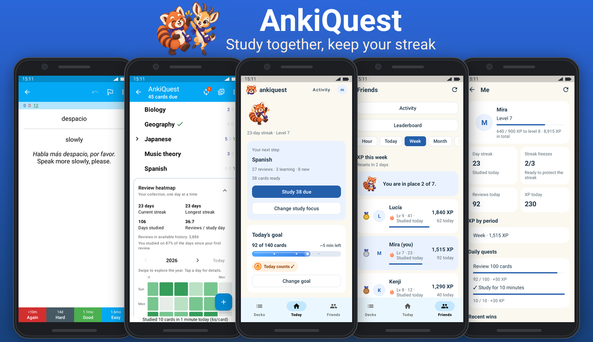

> Anki is hard, free and effective.
>
> Duolingo is easy, commercial and ineffective.
>
> If you ask a random successful language learner what software to use they'll probably suggest Anki.
>
> —lsusr, [Invisible Choices, Made by Default](https://www.lesswrong.com/s/3xKXGh9RXaYTYZYgZ/p/k6nncsXAZD3bK6fe3)

<p align="center">

</p>

<a href="https://github.com/AnkiQuest/AnkiQuest-Android/releases"></a>
<a href="https://github.com/AnkiQuest/AnkiQuest-Android/actions"></a>
<a href="https://github.com/AnkiQuest/AnkiQuest-Android/commits/master"></a>
<a href="https://github.com/AnkiQuest/AnkiQuest-Android/graphs/contributors"></a>
<a href="https://github.com/AnkiQuest/AnkiQuest-Android/blob/master/COPYING"></a>

# AnkiQuest-Android

[AnkiDroid](https://github.com/ankidroid/Anki-Android), the Android port of the open source [Anki](https://apps.ankiweb.net/index.html) spaced repetition flashcard system, with AnkiQuest built in.

AnkiQuest leaves Anki's scheduling unchanged and adds streaks, friends and leaderboards to keep you studying.

AnkiQuest adds XP, streaks, daily quests, friends and leaderboards to Anki. Clients send review history without card content; sharing a conquered card label or a deck copy is an explicit choice. AnkiQuest has three repositories:

- [AnkiQuest-Server](https://github.com/AnkiQuest/AnkiQuest-Server): the server and its website.
- [AnkiQuest-Desktop](https://github.com/AnkiQuest/AnkiQuest-Desktop): the Anki desktop add-on.
- [AnkiQuest-Android](https://github.com/AnkiQuest/AnkiQuest-Android): the Android app, a fork of AnkiDroid.

</img>

### Features

<div style="display:flex;">

- AnkiQuest: XP, streaks, quests, records and a leaderboard widget
- Night mode
- Whiteboard
- Progress widget
- Detailed statistics
- [Review heatmap beneath the deck list](docs/review-heatmap.md)
- Syncing with AnkiWeb
- Write answers (optional)
- Text-to-speech integration
- More than 10,000 premade decks
- Spaced repetition (AI-optimized [FSRS algorithm](https://github.com/open-spaced-repetition))
- Supported contents: text, images, sounds, MathJax
- Add cards by intent from other applications like dictionaries

</div>

## Install

<div style="display:flex;">

1. Create an account on an AnkiQuest server, such as [ankiquest.org](https://ankiquest.org). To run your own, see [AnkiQuest-Server](https://github.com/AnkiQuest/AnkiQuest-Server).
2. Download the APK from [Releases](https://github.com/AnkiQuest/AnkiQuest-Android/releases/latest). It installs next to AnkiDroid as "AnkiQuest" and offers later releases itself. Sync your collection through AnkiWeb as usual.
3. Open **Settings → ankiquest → Account → Sign in or create account**.

<a href="http://apps.obtainium.imranr.dev/redirect.html?r=obtainium://add/https://github.com/AnkiQuest/AnkiQuest-Android">
    </a>

</div>

### Verify the APK

Signing certificate fingerprints of the AnkiQuest release key (`CN=AnkiQuest, O=float3`):

```
SHA-256: B3:97:A6:1E:CF:AF:0F:E3:54:DA:61:17:72:51:5E:68:3C:CB:6F:D0:E9:52:D4:77:B8:B3:BC:A4:9E:6C:49:0D
SHA-1:   74:A5:0A:AA:20:37:2D:88:B2:B7:42:64:66:34:7B:9F:7C:28:31:E9
```

Compare the fingerprint with one of:

- [AppVerifier](https://github.com/soupslurpr/AppVerifier) or [Obtainium](https://github.com/ImranR98/Obtainium), which show the installed app's signing certificate.
- `apksigner verify --print-certs AnkiQuest.apk`, from Android SDK build-tools. Look for `CN=AnkiQuest, O=float3`, the v3 signer for Android 9 and newer. Recent build-tools label it `V3.0 Signer`.

Releases and nightlies are signed with the same key, in [ankiquest_apk.yml](.github/workflows/ankiquest_apk.yml). The key replaced a public test key (`tools/fallback-release-keystore.jks`, `CN=Sahil Ahmad`, SHA-256 `0A:8E:BE:EA:…:E4:2A`) through key rotation, which Android supports from 9 on. That key's password is public, so its fingerprint proves nothing:

- On Android 7 and 8, and in the v1/v2 signatures `keytool -printcert -jarfile` reads, the APK shows only the test key.
- Builds without the release key (forks, workflow runs without the signing secret) are signed with the test key only. Don't install them as AnkiQuest.

For everything Anki, AnkiDroid's [user manual](https://docs.ankidroid.org/), [wiki](https://github.com/ankidroid/Anki-Android/wiki) and community ([Discord](https://discord.gg/qjzcRTx), [Reddit](https://www.reddit.com/r/Anki), [Anki forums](https://forums.ankiweb.net/)) apply here too. Report AnkiQuest bugs and ideas in [Issues](https://github.com/AnkiQuest/AnkiQuest-Android/issues).

## Development

```sh
./gradlew ktlintCheck
./gradlew :AnkiDroid:testPlayDebugUnitTest --tests '…'
node --test .github/tests/*.test.cjs
```

The GitHub release APK is built with:

```sh
SOURCE_DATE_EPOCH="$(git log -1 --format=%ct)" ./gradlew :AnkiDroid:assembleFullRelease \
  -Duniversal-apk=true -PcustomSuffix=quest -PcustomName="AnkiQuest" -PankiquestUpdates=github
```

`-PankiquestUpdates=github` builds in the self-updater, which installs new releases from GitHub and requests `REQUEST_INSTALL_PACKAGES`. Without it (`none`, the default) the app neither checks for updates nor requests the permission: use that for store builds (F-Droid, IzzyOnDroid, Play), whose store updates them. Rebuilding the release APK for comparison takes `github`, as in `ankiquest_reproducible.yml`.

AnkiQuest code is in `AnkiDroid/src/main/java/com/ichi2/anki/ankiquest/`; [AGENTS.md](AGENTS.md) has the rules. Pull requests are welcome [here](https://github.com/AnkiQuest/AnkiQuest-Android/pulls). Changes that are not about AnkiQuest belong [upstream](https://github.com/ankidroid/Anki-Android); see AnkiDroid's [contribution guide](https://github.com/ankidroid/Anki-Android/wiki/Contributing).

## Credits
<!--- Do not rename this section. AnkiDroid contains a deep link to the section
header - see https://github.com/ankidroid/Anki-Android/pull/11803 --->

### Code Contributors

AnkiQuest for Android is built on the work of [AnkiDroid's contributors](https://github.com/ankidroid/Anki-Android/graphs/contributors). See also [this fork's contributors](https://github.com/AnkiQuest/AnkiQuest-Android/graphs/contributors).

### Art

Anki-tan (`anki_tan_*.webp`) is by [Shigeyuki](https://www.patreon.com/Shigeyuki), from the [Anki-tan asset pack](https://shigeyukey.github.io/shige-addons-wiki/Anki-tan.html), licensed [CC BY-SA 4.0](https://creativecommons.org/licenses/by-sa/4.0/). Derivatives of her art are CC BY-SA 4.0 too. See [docs/branding/anki-tan.md](docs/branding/anki-tan.md).

### [Translators](https://crowdin.com/project/ankidroid/activity-stream)

Thanks to our 1400 translators, for allowing us to be available, partially or totally, in 99 languages as of July 2022.

## License

* [GPL-3.0 License](https://github.com/AnkiQuest/AnkiQuest-Android/blob/master/COPYING) for AnkiDroid, including the AnkiDroid files this fork modifies
* [AGPL-3.0 License](https://github.com/AnkiQuest/AnkiQuest-Android/blob/master/LICENSES/AGPL-3.0-or-later.txt), version 3 or (at your option) any later version, for the AnkiQuest code: every file marked `SPDX-License-Identifier: AGPL-3.0-or-later`, plus `docs/branding/`, `docs/review-heatmap.md`, the `aki_*.png` artwork, `AnkiDroid/src/test/resources/ankiquest/`, `AnkiDroid/src/main/assets/ankiquest/release-notes.md` and `tools/ankiquest-signing-lineage.bin`. As GPLv3 section 13 allows, the app combines both, and the AGPL's network-interaction terms apply to the combined work
* [AGPL-3.0 License](https://github.com/ankitects/anki/blob/main/LICENSE) for some part of the back-end
* [CC BY-SA 4.0 License](https://github.com/AnkiQuest/AnkiQuest-Android/blob/master/LICENSES/CC-BY-SA-4.0.txt) for the Anki-tan artwork (`anki_tan_*.webp`), by Shigeyuki
* [LGPL-3.0 License](https://github.com/AnkiQuest/AnkiQuest-Android/blob/master/api/COPYING.LESSER) for the AnkiDroid API
